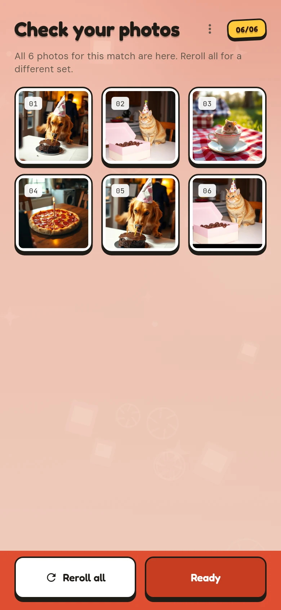
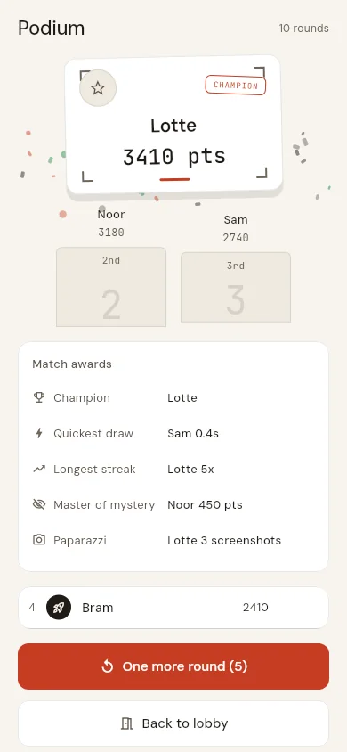
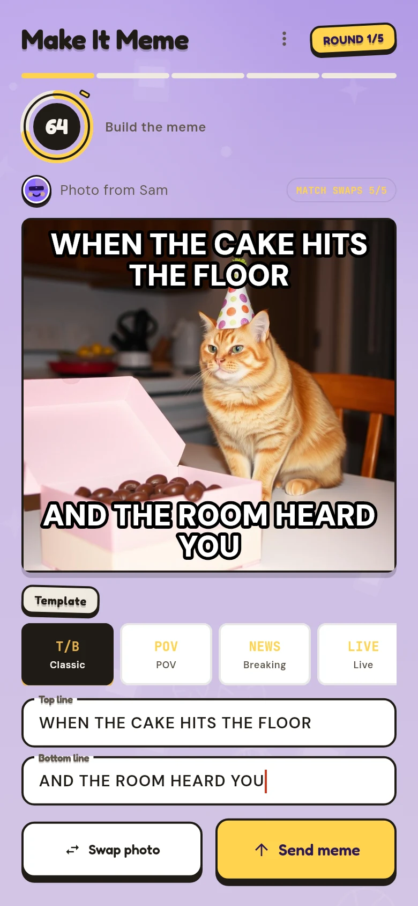

# WhoTook

A party game for your camera roll. One phone starts a room, everyone joins with a
QR code, and the table guesses photos, makes memes from each other's camera rolls,
and travels through time. Choose an avatar, play in English or Nederlands, and
rejoin your last room after a restart.

[](https://github.com/warreth/WhoTook/actions/workflows/ci.yml)
[](https://github.com/warreth/WhoTook/actions/workflows/release.yml)

| Round | Lobby | Make It Meme vault | Podium |
| --- | --- | --- | --- |
|  |  |  |  |

## Game modes

- **Classic:** guess who took the photo.
- **Make It Meme:** everyone brings six photos, you get one from someone else, build a template, then vote up, meh or down.
- **Time Traveler:** pick a decade, year and month, then read the evidence timeline.
- **Mixed Party:** Classic, Make It Meme and Time Traveler, shuffled.

| Pick a mode | Make It Meme | Time Traveler |
| --- | --- | --- |
|  |  |  |

## Download

- **Android:** [WhoTook.apk](https://github.com/warreth/WhoTook/releases/latest/download/WhoTook.apk) is the universal build, Android 7.0 and newer. Most phones can use the smaller `WhoTook-<version>-arm64-v8a.apk` from the release page.
- **Automatic updates:** [Add to Obtainium](https://apps.obtainium.imranr.dev/redirect?r=obtainium%3A%2F%2Fadd%2Fhttps%3A%2F%2Fgithub.com%2Farreth%2FWhoTook), or paste the repository URL in Obtainium.
- **iPhone:** sideload `WhoTook-<version>-unsigned.ipa` (or the stable `WhoTook-unsigned.ipa`) with SideStore or AltStore, or build from source. App Store release is coming.
  Add the source in the app: `https://whotook.party/altstore.json`.
- **Website:** [whotook.party](https://whotook.party).
- **Support:** [hello@whotook.party](mailto:hello@whotook.party) or [whotook.party/support](https://whotook.party/support).

## How it plays

1. **Set the table.** Pick a game mode, the rounds and the pace. Open the room and show the QR code.
2. **Join and fill the vault.** Everyone joins from their own phone, picks a name and avatar, then approves their photos (six for Make It Meme). A selfie, a gallery photo or an icon all work as an avatar.
3. **Guess, meme or time travel.** Classic asks who took it. Make It Meme gives you a friend's photo, seven templates and five match-wide swaps. Time Traveler asks for the date. If a connection drops, the phone reconnects to the same room and picks up the round.
4. **Crown a winner.** The podium hands out awards and saves the top memes. Play five more rounds, head back to the lobby to change the game or add players, or skip a stuck round from the host menu.

Two to twelve players. No accounts, no ads, no analytics.

## Privacy

Photos are resized and stripped of EXIF on the phone that owns them, shared only
with the players in the match, and held in memory. On the same Wi-Fi or hotspot,
the host phone runs the game and nothing leaves the network. Online play uses an
encrypted WebRTC connection and a small Cloudflare Worker for signaling.

Read the [privacy notes](https://whotook.party/privacy) or the
[technical notes](https://whotook.party/technical).

## Build it

```bash
cd app
flutter pub get
flutter run
```

Local play needs no server. To run online play against your own signaling
server and `coturn` relay, read [SELF_HOSTING.md](SELF_HOSTING.md). The official
hosted signaling and relay deployment is maintained in a separate private
repository.

For a tracker-free build with no store billing and no official relay client:

```bash
bash app/foss/build.sh
```

For a quick runtime check, `cd app && flutter run --dart-define=FOSS_BUILD=true`
also disables billing and the official relay; the script is the dependency-clean
build. The FOSS build includes the live soundboard and all room themes for free, and
uses only a TURN server you configure yourself. Store builds optionally sell
the **WhoTook Party Pass** (one-time, `whotook_party_pass`) for the hosted 5G
relay, the soundboard and shared themes. Local P2P play is free in every build.
Receipts are verified by the private backend; the app never contains the
verification secret. Details are in [SELF_HOSTING.md](SELF_HOSTING.md).

The code is [AGPLv3](LICENSE). The **WhoTook** name and the viewfinder logo are
trademarks: forks are welcome, but a distributed fork needs its own name and
icon. See [TRADEMARK.md](TRADEMARK.md). Issues and pull requests are welcome at
[github.com/warreth/WhoTook](https://github.com/warreth/WhoTook).
