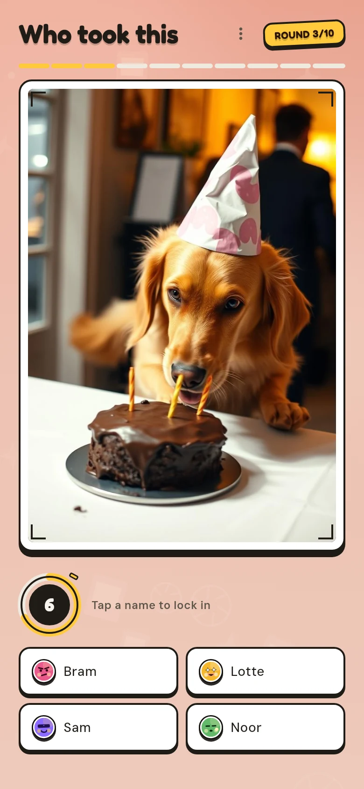
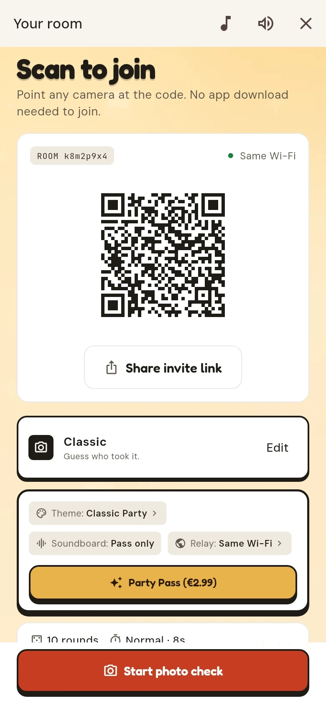
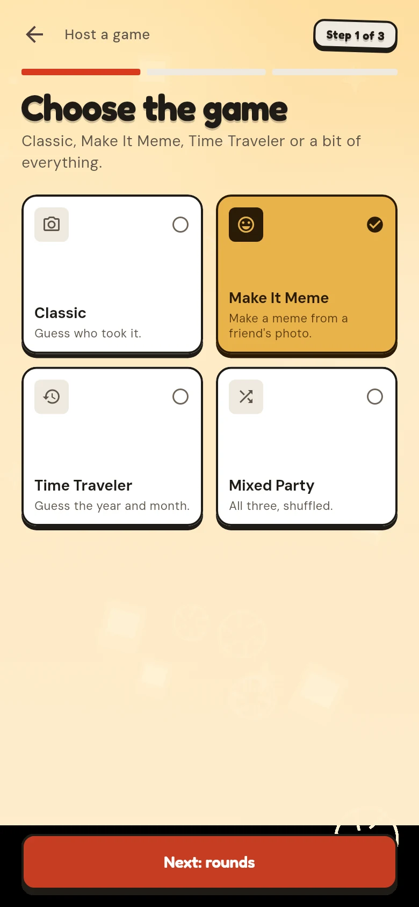
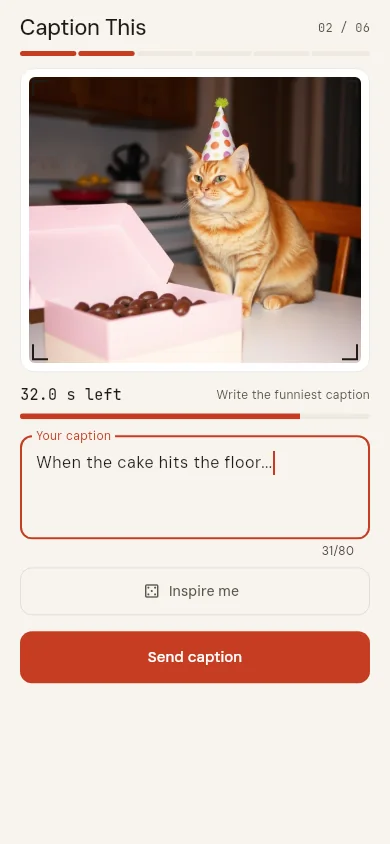
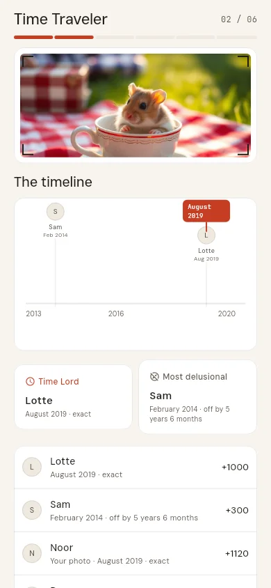

# WhoTook

A party game for your camera roll. One phone starts a room, everyone joins with a
QR code, and each round shows a photo while the table races to guess who took it.

[](https://github.com/warreth/WhoTook/actions/workflows/ci.yml)
[](https://github.com/warreth/WhoTook/actions/workflows/release.yml)

| Round | Lobby | Pick your photos | Podium |
| --- | --- | --- | --- |
|  |  |  |  |

## Game modes

- **Classic:** guess who took the photo.
- **Caption This:** write the funniest caption, then vote anonymously.
- **Time Traveler:** guess the year and month on a timeline.
- **Mixed Party:** all three, shuffled.

| Pick a mode | Caption This | Time Traveler |
| --- | --- | --- |
|  |  |  |

## Download

- **Android:** [WhoTook.apk](https://github.com/warreth/WhoTook/releases/latest/download/WhoTook.apk), Android 7.0 and newer.
- **Automatic updates:** [Add to Obtainium](https://apps.obtainium.imranr.dev/redirect?r=obtainium%3A%2F%2Fadd%2Fhttps%3A%2F%2Fgithub.com%2Farreth%2FWhoTook), or paste the repository URL in Obtainium.
- **iPhone:** sideload the unsigned IPA with SideStore or AltStore, or build from source. App Store release is coming.
  Add the source in the app: `https://whotook.party/altstore.json`.
- **Website:** [whotook.party](https://whotook.party).

## How it plays

1. **Start a room.** Pick the rounds and the timer, then show the QR code.
2. **Pick your photos.** Everyone approves a handful of photos from their own phone. Swap anything you would rather keep out.
3. **Guess who took it.** A photo appears and everyone taps a name. Faster correct guesses score more.
4. **Crown a winner.** The podium hands out awards. Play five more rounds if nobody wants to stop.

Two to twelve players. No accounts, no ads, no analytics.

## Privacy

Photos are resized and stripped of EXIF on the phone that owns them, shared only
with the players in the match, and held in memory. On the same Wi-Fi or hotspot,
the host phone runs the game and nothing leaves the network. Online play uses an
encrypted WebRTC connection and a small Cloudflare Worker for signaling.

Read the [privacy notes](https://whotook.party/privacy) or the
[technical notes](https://whotook.party/technical).

## Build it

```bash
cd app
flutter pub get
flutter run
```

Android release signing reads `app/android/key.properties` (git-ignored). Copy
`app/android/key.properties.example` and point it at your keystore. Without it,
release builds fall back to the debug key, which is fine for local testing and
wrong for a store.

The signaling Worker and website live in `cloudflare-signaling/`:

```bash
cd cloudflare-signaling
npm install
npm test
npx wrangler dev
```

## Store releases

The `Release` workflow builds a signed APK and AAB on every `v*` tag and attaches
them to a GitHub release. Bump `version` in `app/pubspec.yaml` before tagging; the
workflow refuses a tag that does not match. Google Play and App Store uploads are optional and skip
when their secrets are missing. Add them when the listings are ready:

| Secret | Purpose |
| --- | --- |
| `PLAY_SERVICE_ACCOUNT_JSON` | Google Play service account JSON |
| `IOS_DIST_CERT_P12_BASE64` | Apple distribution certificate (base64) |
| `IOS_DIST_CERT_PASSWORD` | Certificate password |
| `IOS_PROVISIONING_PROFILE_BASE64` | App Store provisioning profile (base64) |
| `IOS_TEAM_ID` | Apple Developer Team ID |
| `APPSTORE_API_KEY_ID` | App Store Connect API key ID |
| `APPSTORE_API_ISSUER_ID` | App Store Connect issuer ID |
| `APPSTORE_API_PRIVATE_KEY` | App Store Connect `.p8` contents |

Android signing uses `ANDROID_KEYSTORE_BASE64`, `ANDROID_KEYSTORE_PASSWORD`,
`ANDROID_KEY_ALIAS` and `ANDROID_KEY_PASSWORD`. The App Links fingerprint in
`cloudflare-signaling/wrangler.jsonc` must match the certificate that ends up on
the phone. With Play App Signing, that is the Play Console app signing
certificate, not the upload key.

## Repository

| Path | Contents |
| --- | --- |
| `app/` | Flutter app, Android 7.0+ and iOS 15+ |
| `cloudflare-signaling/` | Worker, Durable Objects, website and invite page |
| `.github/workflows/` | CI and release automation |

The code is [AGPLv3](LICENSE). The **WhoTook** name and the viewfinder logo are
trademarks: forks are welcome, but a distributed fork needs its own name and
icon. See [TRADEMARK.md](TRADEMARK.md). Issues and pull requests are welcome at
[github.com/warreth/WhoTook](https://github.com/warreth/WhoTook).
